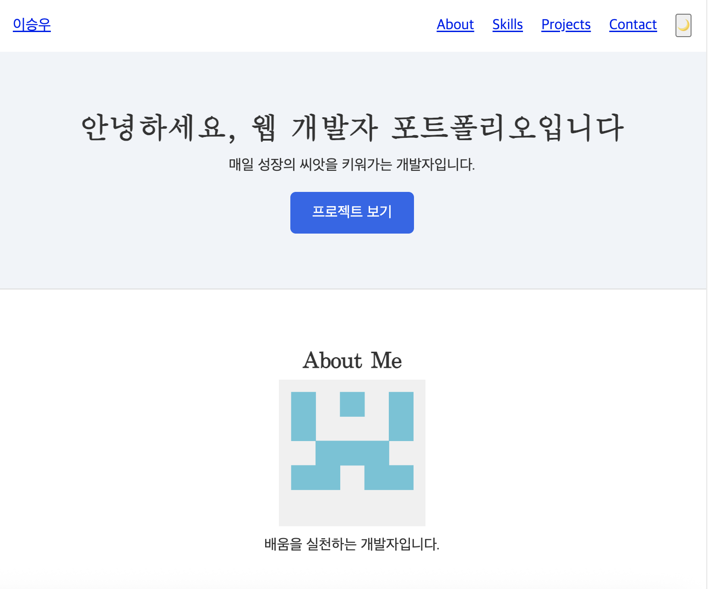
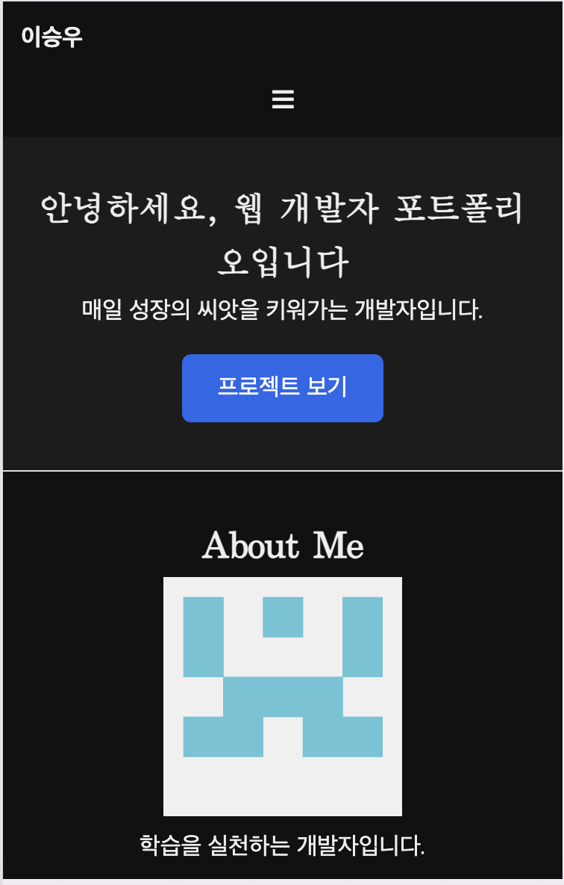

# website-project

나를 소개하는 반응형 포트폴리오 웹사이트입니다. 폰, 태블릿, 데스크톱 화면에 맞춰 레이아웃이 바뀌고, GitHub 저장소 목록을 API로 불러와 보여 줍니다.

**배포 주소:** https://sw0410.github.io/website-project/

## 화면

<!--
  📸 스크린샷 넣는 자리 (이 주석은 GitHub 화면에 안 보임)
  1) images/screenshot-desktop.png : 넓은 창, 라이트 모드, 메뉴 + Hero가 보이게
  2) images/screenshot-mobile.png  : 폭 375px, 다크 모드, Hero 또는 Projects 카드가 보이게
  두 파일을 images 폴더에 위 이름으로 넣으면 아래 표에 자동으로 나타난다.
-->

| 데스크톱 (1024px, 라이트) | 모바일 (375px, 다크) |
| --- | --- |
|  |  |

## 사용 기술

| 구분 | 내용 |
| --- | --- |
| HTML | 시맨틱 태그(`header`, `nav`, `main`, `section`, `article`, `footer`), `label`로 연결한 폼 |
| CSS | CSS 변수(색·간격), Flexbox, Grid(`auto-fit` + `minmax`), 모바일 퍼스트 `@media (min-width)`, `transition`, `box-shadow` |
| JavaScript | ES6+(화살표 함수, 구조분해, 템플릿 리터럴, `async`/`await`), `fetch`, `IntersectionObserver`, `localStorage` |
| 배포 | GitHub Pages |

## 섹션 구성

Hero · About · Skills · Projects · Contact · Footer

## 기능

| 기능 | 동작 |
| --- | --- |
| 반응형 | 기본은 폰 화면, 768px·1024px 이상에서 메뉴를 가로로 펼치고 여백·제목을 키운다 |
| 햄버거 메뉴 | 좁은 화면에서 ☰를 누르면 메뉴가 열리고 닫힌다 |
| 다크 모드 | 🌙 버튼으로 전환하고 `localStorage`에 저장해 새로고침 후에도 유지된다 |
| 부드러운 스크롤 | 메뉴·CTA 링크를 누르면 해당 구역으로 부드럽게 이동한다 |
| 스크롤 등장 | 구역이 화면에 들어오면 서서히 나타난다 |
| 맨 위로 버튼 | 아래로 내리면 나타나고, 누르면 맨 위로 부드럽게 이동한다 |
| nav 배경 | 조금 내리면 메뉴 줄의 배경과 그림자가 바뀐다 |
| GitHub 저장소 | GitHub API로 저장소 목록을 불러와 카드로 그린다. 로딩·에러·빈 상태 문구를 보여 주고, 에러일 때 재시도 버튼이 나타난다 |
| 폼 유효성 검사 | 이름·이메일·메시지 필수값과 이메일 형식을 검사해 칸마다 오류를 보여 준다. 입력하면 그 칸의 오류가 사라지고, 모두 맞으면 성공 메시지를 보여 준다 |

## 기준값

| 값 | 쓰이는 곳 |
| --- | --- |
| `300px` | 이만큼 넘게 내리면 맨 위로 버튼이 나타난다 |
| `60px` | 이만큼 넘게 내리면 nav 배경이 바뀐다 |
| `threshold: 0.2` | 구역이 20% 이상 화면에 들어오면 스크롤 등장 애니메이션이 시작된다 |
| `768px`, `1024px` | 넓은 화면 레이아웃으로 바뀌는 브레이크포인트 |

## 구조

```
website-project/
├── index.html        페이지 구조와 내용
├── css/style.css     모양(색, 간격, 배치, 반응형)
├── js/script.js      동작(STATE → render 흐름)
└── images/           프로필 이미지, 스크린샷
```

화면에 보이는 상태는 모두 `STATE` 객체 하나에 담고, 이벤트가 일어나면 `STATE`를 바꾼 뒤 `render()`가 `STATE`를 보고 화면을 다시 그립니다.